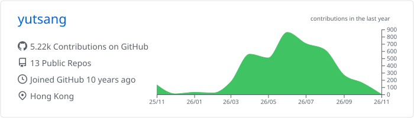

<h2>Data, code, and experiments</h2>

<a href="https://ytsang.com">Website</a> · <a href="mailto:contact@ytsang.com">Contact</a>

Interested in data analysis, automation, and open-source tools.

<h3>💻&nbsp;Languages and Tools</h3>

&nbsp;
  
  
  
  
  
  

 

<!-- Profile card: .github/workflows/profile-summary-cards.yml -->

  
  &nbsp;
  

 
